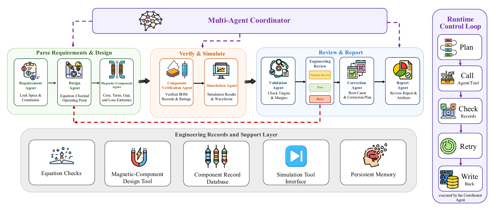
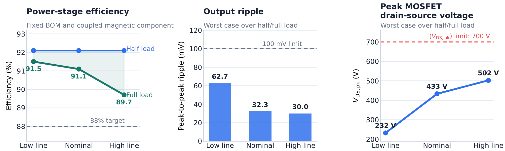

<div align="center">

# PE-GPT 2.0

### A Trustworthy Multi-Agent Design Framework for Power Converters

**Shi Qiu · Fanfan Lin · Xinze Li**

[](https://irai2026.ieee-ies.org/program/index.html)
[](https://irai2026.ieee-ies.org/for_authors/travel-grants/index.html)
[](https://www.youtube.com/watch?v=JzlFLe246RY)

[Presentation](#official-ieee-ies-presentation) · [Framework](#framework) · [Quick start](#quick-start) · [Paper results](#paper-results) · [Citation](#citation)

</div>

PE-GPT 2.0 turns power-converter requirements into a traceable engineering design workflow. Specialized agents coordinate equation checks, magnetic-component design, component-record verification, PLECS simulation, validation, and correction through a browser-based design studio.

The current research implementation focuses on **isolated flyback converters**. Engineering records and review gates make the assumptions, measurements, and remaining work visible throughout the process.

## Official IEEE IES presentation

<p align="center">
  <a href="https://www.youtube.com/watch?v=JzlFLe246RY">
    
  </a>
</p>

<p align="center"><strong><a href="https://www.youtube.com/watch?v=JzlFLe246RY">▶ Watch the presentation</a></strong><br>Published by the <a href="https://www.youtube.com/@ieee-ies">IEEE Industrial Electronics Society</a>.</p>

- **Accepted paper:** IEEE International Conference on Responsible Artificial Intelligence (**IRAI 2026**). [Official conference program](https://confcomm-public.s3.amazonaws.com/share/IRAI26/IRAI26_program.pdf)
- **Hackathon finalist:** IEEE IES Generative AI Hackathon.
- **Travel award:** Shi Qiu received the **IEEE IES SYPA Travel Award**, as one of ten recipients.

## Framework

[](assets/framework.png)

*Eight specialized agents work under a coordinator, supported by equation checks, magnetic-design tools, component records, simulation interfaces, and persistent memory. Figure extracted directly from the paper; click to enlarge.*

| Stage | What the workflow provides |
| --- | --- |
| Requirements & design | Structured specifications, explicit assumptions, topology reasoning, and equation-checked operating points |
| Magnetics & components | Magnetic-component advice and checks against available component records |
| Simulation & validation | PLECS integration, numerical checks, operating-condition review, and correction feedback |
| Review & reporting | Engineering records, workflow traces, structured reports, and explicit human review gates |

The Studio combines a **FastAPI backend**, a **browser interface**, and a **LangGraph-based flyback workflow**. PLECS measurements are required for simulation-backed claims; planning output alone is not a verified design.

## Quick start

Use **Python 3.12** and an internet connection for installation and the Studio's browser libraries.

```bash
git clone https://github.com/spongelovesorange/PE-GPT-2.0.git
cd PE-GPT-2.0
python3 -m venv .venv
source .venv/bin/activate
python -m pip install -r requirements.txt
cp .env.example .env
python server.py
```

Open **http://127.0.0.1:8000**. The example configuration starts the Studio on your local machine. On Windows, create the environment with `py -3.12 -m venv .venv` and activate it with `.venv\Scripts\Activate.ps1` in PowerShell.

### Connect your tools

Edit `.env` before running model-backed design tasks:

| Configuration | Purpose |
| --- | --- |
| `PE_MAS_LLM_CREDENTIAL` | Your model-provider credential |
| `PE_MAS_LLM_ENDPOINT` | Optional OpenAI-compatible API base address |
| `PE_MAS_LLM_MODEL` | Chat model ID available from your provider |
| `PE_MAS_REQUIREMENTS_MODEL` | Requirements-analysis model ID |
| `PE_MAS_REASONING_MODEL` | Agent-reasoning model ID |
| `PLECS_RPC_URL` | XML-RPC address of your running, licensed PLECS Standalone installation |

The three model roles can use the same model. Credentials stay in the ignored `.env` file. The `PE_MAS_*` setting names are retained for compatibility with the earlier PE-MAS release.

PLECS is needed for real simulation evidence. To serve only the API, set `PE_MAS_APP_MODE=api` in `.env` and run `python server.py`; API documentation is available at `/docs`, with health status at `/api/health`.

## Paper results

The paper evaluates **96 isolated flyback cases**, with additional tolerance and repeatability studies.

| Evaluation | Reported result |
| --- | --- |
| Engineering verification | **31 / 96** cases passed the paper's engineering checks |
| Contribution of correction | **14** passed initially; **17** additional cases passed after correction |
| Tolerance study | **731 / 800 (91.4%)** samples met the numerical targets |
| Repeatability | **57 / 60 (95.0%)** runs reproduced the same final decision |

[](assets/line-load-sweep.png)

*Paper case study: a 12 V / 2 A flyback design evaluated across line and load conditions with a fixed BOM and magnetic component, without reoptimization. These are simulated power-stage results. “Engineering verified” refers to the paper's checks, not hardware qualification or production certification.*

## Repository guide

```text
app/          FastAPI backend, Studio runtime, API routes and schemas
core/         Flyback workflow, domain equations, agents and knowledge services
data/         Topology data and PLECS model registry
frontend/     Browser-based design Studio
plecs-mcp/    Optional PLECS integration helper
assets/       Two figures extracted from the paper
server.py     Application entry point
```

Start with `core/flyback_mas/graph.py` for the design workflow and `app/studio.py` for its Studio integration. Local reports, cached data, credentials, and simulation output stay outside version control. Some general-purpose adapters and agent extensions remain placeholders; the evaluated workflow is the isolated flyback path. Thermal, feedback-loop, EMI/safety, and release decisions still require appropriate engineering evidence and human review.

## Citation

**PE-GPT 2.0: A Trustworthy Multi-Agent Design Framework for Power Converters**

Shi Qiu, Fanfan Lin, and Xinze Li. Accepted at **IEEE IRAI 2026**.

```bibtex
@inproceedings{qiu2026pegpt2,
  title     = {PE-GPT 2.0: A Trustworthy Multi-Agent Design Framework for Power Converters},
  author    = {Qiu, Shi and Lin, Fanfan and Li, Xinze},
  booktitle = {IEEE International Conference on Responsible Artificial Intelligence (IRAI)},
  year      = {2026},
  note      = {Accepted}
}
```

## Acknowledgments

This work builds on the original [PE-GPT project](https://github.com/XinzeLee/PE-GPT) and acknowledges the **IEEE Industrial Electronics Society Generative AI Hackathon**. Original source-code attributions and third-party component/model notices are retained.
